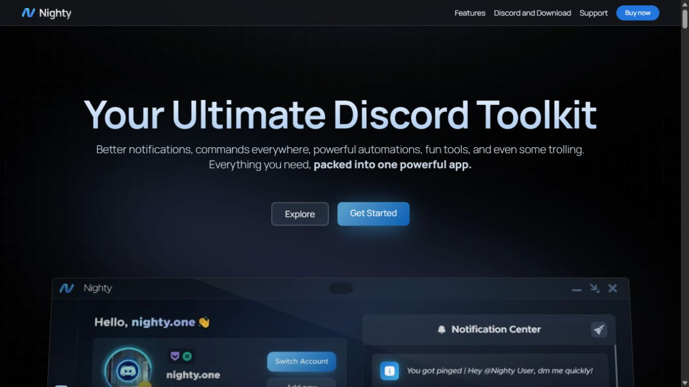

# Nighty Website Recreation

A website recreation study based on [nighty.one](https://nighty.one/). It keeps the public site's layout, fonts, images, videos and browser animations, with a small Node.js server for local use.



## Run it locally

Install [Node.js](https://nodejs.org/) 22.12 or newer, then run:

```sh
git clone https://github.com/itszyless/nighty-website-recreation.git
cd nighty-website-recreation
npm run dev
```

Open **http://localhost:5175**.

There are no packages to install. On Windows, you can also double-click `start.cmd`.

To use a different port in PowerShell:

```powershell
$env:PORT=5180
npm run dev
```

## Included pages

| Path | Content |
| --- | --- |
| `/` | Full homepage with animated sections |
| `/commands` | Public catalog with 209 command entries |
| `/get-links` | Customer access form preview |
| `/terms-of-service` | Terms page |
| `/commands/get` | Saved command data |
| `/get-links/discord` | Redirect to the access form |
| `/get-links/download` | Unauthorized response |
| Other paths | Not found page |

The homepage includes the feature carousel, command preview controls, profile animations, notification video, interface tabs, reseller panel and mobile menu.

## How it works

This project contains saved public HTML and browser bundles from the reference site, captured on 17 October 2026. It is not a rewrite of Nighty's private source code.

The original public frontend uses Next.js and motion effects. It does not contain a Three.js scene. Local page navigation loads the saved HTML instead of calling a Next.js server.

Images, fonts, feature videos and command data are served from this folder. The server supports video range requests. The YouTube showcase and external support, shop and documentation links need internet access.

## Local limits

License verification, CAPTCHA verification and protected customer downloads need Nighty's private server. This version uses a labeled local checkbox and a local message. It does not send or save license keys, and it does not include the Nighty desktop app.

Analytics and Cloudflare challenge scripts are removed. The server listens only on this computer.

## Project files

- `pages/`: saved page HTML
- `public/assets/`: images and videos
- `public/_next/static/`: browser bundles, CSS and fonts
- `data/commands.json`: public command catalog
- `local-runtime.js`: local navigation and form behavior
- `server.mjs`: localhost server and asset routes
- `scripts/check.mjs`: page and asset checks

## Checks

```sh
npm run build
```

This checks the saved pages, referenced assets and command data. It does not compile a new frontend bundle. The site was also checked in a browser at desktop and mobile sizes.

## Credits and rights

Reference: [Nighty](https://nighty.one/).

Nighty branding, text, images, videos, fonts and browser code belong to their respective owners. This repository is an independent recreation study and is not affiliated with Nighty. No ownership or open-source license is claimed for third-party material. Its presence here does not grant permission to reuse it.
